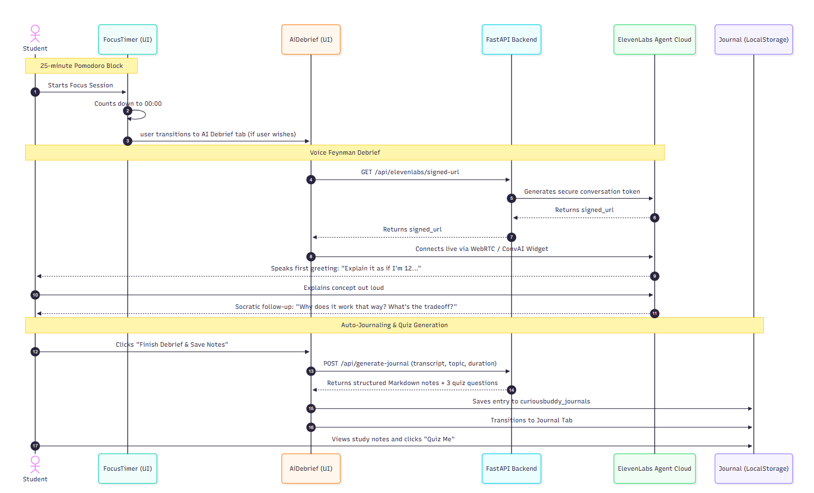
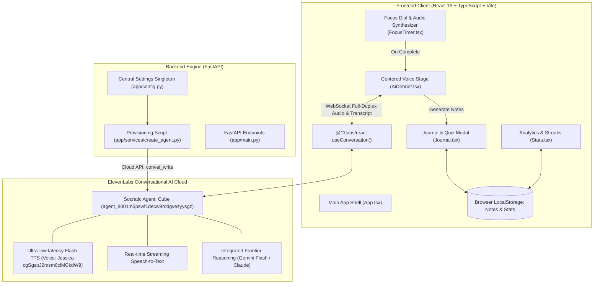

# 🧠🎙️ curiousBuddy

<div align="center">

> **Don't just re-read. Explain it to Cube.**  
> An open-source, active-learning Pomodoro study companion built with **ElevenLabs Conversational AI** ("Cube"), the **Feynman Technique**, **FastAPI**, and **React 19** that turns 25-minute focus sprints into deep comprehension, automated study journals, and active recall quizzes.

[](http://localhost:5173)
[](http://127.0.0.1:8000/api)
[](LICENSE)

<br/>

[](https://elevenlabs.io)
[](https://fastapi.tiangolo.com)
[](https://react.dev)
[](https://www.typescriptlang.org)
[](https://python.org)
[](https://developer.mozilla.org/en-US/docs/Web/API/Web_Audio_API)

</div>

---

## 📑 Table of Contents

- [The Problem & Vision](#-the-problem--vision)
- [Key Features](#-key-features)
- [How It Works (User Journey)](#-how-it-works-user-journey)
- [System Architecture](#-system-architecture)
- [Deep Dive: Socratic Feynman Engine & Conversational Voice Agent ("Cube")](#-deep-dive-socratic-feynman-engine--conversational-voice-agent-cube)
- [Project Directory Structure](#-project-directory-structure)
- [📋 What We Have Done Till Now & Roadmap (TODOs)](#-what-we-have-done-till-now--roadmap-todos)
  - [Completed Milestones](#-completed-milestones-what-we-have-done-till-now)
  - [Upcoming Roadmap](#-upcoming-roadmap-what-to-do-next)
- [API Reference & Integrations](#-api-reference--integrations)
- [Getting Started Locally](#-getting-started-locally)
- [Environment Variables](#-environment-variables)
- [Contributing & License](#-contributing--license)

---

## 🎯 The Problem & Vision

Traditional study sessions suffer from the **Illusion of Competence**:

- 📖 **Passive Highlighting & Re-reading**: Reading a textbook chapter or watching lecture videos tricks our brains into mistaking familiarity for genuine mechanical mastery.
- 🌫️ **Hiding Behind Buzzwords**: When asked to explain a topic, students lean on technical jargon rather than understanding fundamental mechanics and causal relationships.
- ⌛ **The Missing Feedback Loop**: Solitary Pomodoro timers ring at 25 minutes, but offer zero interactive reflection. Students check their phones instead of consolidating neural pathways.

### The Solution: The Feynman Technique Meets Conversational Voice AI

**curiousBuddy** enforces Richard Feynman’s timeless learning rule:  
> *"If you can't explain it simply to a 12-year-old, you don't understand it yet."*

1. **Sprint**: Focus on any subject for 25 minutes in a distraction-free, obsidian dark Pomodoro dial.
2. **Debrief**: When the chime sounds, transition straight into a live spoken debrief with **Cube**, your curious Socratic study buddy powered by ElevenLabs Conversational AI.
3. **Challenge**: Cube playfully challenges jargon, asks probing *“why”* and *“how”* follow-ups, and prompts simple analogies until deep mechanical understanding is proven.
4. **Consolidate**: Every debrief automatically converts into a structured markdown journal entry with 3 active-recall quiz questions to lock in retention.

---

## ✨ Key Features

| Feature | Description |
| :--- | :--- |
| ⏱️ **Precision Pomodoro Engine** | Minimal circular clock dial supporting **25m Focus**, **5m Short Break**, and **15m Long Break** intervals with customizable study topic tags and Web Audio synthesizer chimes. |
| 🎙️ **Centered Socratic Voice Agent ("Cube")** | Live, full-duplex spoken conversation powered by **ElevenLabs Conversational AI** (`@11labs/react`). Features real-time speaking/listening state detection and live transcript streaming. |
| 👧 **Playful Youthful Persona (Jessica)** | Voiced with ElevenLabs' expressive Jessica voice (`cgSgspJ2msm6clMCkdW9`), giving Cube an eager, slightly skeptical persona that insists on simple explanations without jargon. |
| 📝 **Automated Study Journal** | 1-click transformation of verbal Feynman debriefs into structured Markdown study notes capturing core principles, eliminated jargon, and mechanical trade-offs. |
| 🧠 **Interactive "Quiz Me" Recall** | Generates dynamic 3-question active recall quizzes from every saved journal entry to test retrieval strength before the next sprint. |
| 📊 **Focus Analytics & Daily Streaks** | Tracks total minutes studied, completed focus cycles, and daily consistency streaks locally in browser storage with zero external tracking. |

---

## 🔄 How It Works (User Journey)

```text
  ┌─────────────────────────────────────────────────────────────────────────────┐
  │                           1. FOCUS SPRINTS (POMODORO)                       │
  │  Type your study topic: "Distributed Consensus & Raft Protocol".            │
  │  Start the 25:00 dial. Web Audio chime rings upon completion.               │
  └──────────────────────────────────────┬──────────────────────────────────────┘
                                         │
                                         ▼
  ┌─────────────────────────────────────────────────────────────────────────────┐
  │                      2. LIVE VOICE DEBRIEF WITH CUBE                        │
  │  Transition to AI Debrief. Tap "Start Spoken Debrief with Cube".            │
  │  Cube (Jessica voice) greets: "Hey there! Explain Raft like I'm 12!"        │
  │  You speak out loud. Cube detects jargon and probes edge cases.             │
  └──────────────────────────────────────┬──────────────────────────────────────┘
                                         │
                                         ▼
  ┌─────────────────────────────────────────────────────────────────────────────┐
  │                      3. AUTO-JOURNAL & KNOWLEDGE LOCK-IN                    │
  │  Click "Save to Journal". Live spoken transcript transforms into structured │
  │  notes with 3 instant retention quiz questions.                             │
  └──────────────────────────────────────┬──────────────────────────────────────┘
                                         │
                                         ▼
  ┌─────────────────────────────────────────────────────────────────────────────┐
  │                      4. RETENTION QUIZ & STREAK STATS                       │
  │  Open Journal -> click "Quiz Me". Test active recall. Daily stats and focus │
  │  streak update automatically. Take a 5m break, then repeat!                 │
  └─────────────────────────────────────────────────────────────────────────────┘
```

---

## 🏗️ System Architecture

### 1. End-to-End Communication & Data Flow Sequence

<div align="center">



*Figure 1: End-to-end full-duplex voice communication flow between Student, FocusTimer, AiDebrief, FastAPI Backend, ElevenLabs Cloud, and LocalStorage Journal.*

</div>

<br/>

### 2. Component Topology & Service Boundaries



---

## 🔬 Deep Dive: Socratic Feynman Engine & Conversational Voice Agent ("Cube")

### 1. Why ElevenLabs Conversational AI over Local Ollama?
- **Zero Latency Lag**: End-to-end voice loop (Speech-to-Text $\rightarrow$ LLM Reasoning $\rightarrow$ Text-to-Speech) turnaround in $\approx 250\text{ms}$. Local Ollama models add 2–4 seconds of latency and heavy GPU heat.
- **Encyclopedic World Knowledge**: Cube is backed by frontier cloud LLMs natively integrated into ElevenLabs, possessing immediate expertise across system architecture, quantum physics, algorithms, and biology.
- **Zero Local Footprint**: No need to download 4GB GGUF models or run heavy daemons.

### 2. Socratic System Prompt Specification
Cube is governed by the following core instructions provisioned via [create_agent.py](file:///e:/Hackthons/hacktoberfest/curiousBuddy/backend/app/services/create_agent.py):

```markdown
# Personality
Your name is Cube. You are a curious study buddy, an enthusiastic, highly curious, and slightly skeptical study companion.

# Goal
Practice the Feynman Technique with the student.
When they explain what they just studied:
1. Identify any jargon or buzzwords they used and ask them to explain what that actually means in plain, everyday language.
2. Ask probing 'why' and 'how' follow-up questions to test deep mechanical understanding.
3. Challenge them with simple real-world thought experiments and edge cases.
4. Keep your responses conversational, friendly, and concise (2-3 sentences max).

# Tone
Speak in a friendly, conversational manner.
```

### 3. Voice Configuration: Jessica
- **Voice ID**: `cgSgspJ2msm6clMCkdW9`
- **Characteristics**: Playful, clear, curious, youthful. Perfect for the "explain to me like I'm 12" premise.

---

## 📁 Project Directory Structure

```text
curiousBuddy/
├── README.md                              # Comprehensive project documentation
├── plan.md                                # Master architecture & technical milestones
├── start.bat                              # One-click Windows launch script (FastAPI + Vite)
├── LICENSE                                # MIT open-source license
├── backend/
│   ├── .env                              # Backend credentials (ELEVENLABS_API_KEY, ELEVENLABS_AGENT_ID)
│   ├── requirements.txt                  # Python dependencies (fastapi, uvicorn, elevenlabs, pydantic)
│   ├── tests/
│   │   └── test_elevenlabs.py            # Automated tests for API connection & agent creation
│   └── app/
│       ├── config.py                     # Centralized settings singleton (Pydantic + dotenv)
│       ├── main.py                       # FastAPI application entrypoint
│       └── services/
│           └── create_agent.py           # ElevenLabs agent provisioning & updating tool
└── frontend/
    ├── .env                              # Frontend variables (VITE_ELEVENLABS_AGENT_ID)
    ├── index.html                        # App shell & font inclusions (Inter, JetBrains Mono)
    ├── package.json                      # React 19, @11labs/react, Vite, TypeScript
    ├── vite.config.ts                    # Vite dev server & proxy settings
    └── src/
        ├── App.tsx                       # Main shell & tab state (Timer | AI Debrief | Journal | Stats)
        ├── types.ts                      # TypeScript data models (ChatMessage, JournalEntry, UserStats)
        ├── global.d.ts                   # Custom element & React web-component typings
        ├── index.css                     # Global styles, variables, and responsive layout tokens
        ├── utils/
        │   └── sound.ts                  # Web Audio API chime & click synthesizer
        └── components/
            ├── FocusTimer.tsx            # Pomodoro session coordinator & topic selector
            ├── timer/
            │   ├── Focus.tsx             # 25-minute focus session controller
            │   ├── ShortBreak.tsx        # 5-minute break timer
            │   ├── LongBreak.tsx         # 15-minute extended recharge timer
            │   └── ClockDial.tsx         # SVG circular progress dial with electric blue glow
            ├── AiDebrief.tsx             # Centered voice debrief with Cube (@11labs/react)
            ├── Journal.tsx               # Markdown notes viewer & interactive "Quiz Me" modal
            └── Stats.tsx                 # Focus streak counter & lifetime minutes tracker
```

---

## 📋 What We Have Done Till Now & Roadmap (TODOs)

### ✅ Completed Milestones (What We Have Done Till Now)

#### 1. Backend Architecture & Clean Config
- [x] **Config Centralization**: Removed repetitive `.env` file traversal logic across services and unified everything into `app/config.py` using Pydantic's `BaseModel` singleton.
- [x] **ElevenLabs Agent Provisioning Service**: Built `backend/app/services/create_agent.py` to programmatically provision and update conversational agents on ElevenLabs cloud using the official SDK.
- [x] **Automated Test Suite**: Created `backend/tests/test_elevenlabs.py` validating configuration, credentials, and agent creation. All 4 unit tests pass cleanly with exit code 0.
- [x] **Agent Provisioning in Cloud**:
  - **Agent ID**: `agent_8001m5pswf1decw9rddgvezyysgz`
  - **Name**: `curiousBuddy Feynman Debriefer (Cube)`
  - **Voice Config**: Successfully mutated voice to **Jessica** (`cgSgspJ2msm6clMCkdW9` — youthful, playful, high-energy).

#### 2. Frontend Development & Voice Integration
- [x] **Custom Centered Voice Interface**: Replaced generic corner widgets with a custom, centered voice stage using `@11labs/react`'s `useConversation` hook.
- [x] **Reactive Speaking Orb**: Implemented a dynamic glowing orb reflecting agent state (idle, connecting, listening, speaking).
- [x] **Real-Time Live Transcript**: Live conversational stream tracking student explanation and Cube's Socratic questions.
- [x] **Responsive Minimalist Interface**: Polished UI featuring centered voice interaction stage, responsive countdown ring, and clean controls.
- [x] **Pomodoro Focus Timer**: Fully functional 25m Focus, 5m Short Break, and 15m Long Break dials with custom topic selector and Web Audio API synthesized chimes.
- [x] **Auto-Journaling & Quiz System**: Converts debrief transcripts into formatted markdown study journals with 3 active recall questions saved in `localStorage`.
- [x] **Study Analytics**: Real-time streak tracking, total focus sessions, and minutes completed.
- [x] **Developer Experience**: One-click startup script `start.bat` for parallel FastAPI and Vite execution.

---

### 🚀 Upcoming Roadmap (What To Do Next)

#### 1. Real-Time Audio Wave Visualizer
- [ ] Connect `conversation.getOutputByteFrequencyData()` or `conversation.getInputVolume()` to an SVG/Canvas audio waveform surrounding the central orb to visually respond to Cube's speech.

#### 2. Backend Socratic Fallback API Endpoints
- [ ] Implement explicit `/api/chat` and `/api/generate-journal` endpoints in `backend/app/main.py` using Gemini Flash or OpenAI for users who prefer silent text-only debriefs.

#### 3. Voice Switcher Selector
- [ ] Add an in-app voice selector dropdown in the debrief settings drawer to let users quickly switch between **Jessica** (childish/playful), **Brian** (warm/academic), and **Rachel** (calm/focused) dynamically.

#### 4. Spaced Repetition (SM-2 Algorithm)
- [ ] Integrate a spaced repetition scheduling system that calculates next-review dates for journal entries based on quiz performance (1 day, 3 days, 7 days, 14 days).

#### 5. Cloud Sync & Auth
- [ ] Optional user accounts via Supabase / PostgreSQL to sync study notes, audio recordings, and streak statistics across multiple devices.

#### 6. Export Integrations
- [ ] 1-click export of Feynman journal entries to **Notion**, **Obsidian**, and downloadable `.md` files.

#### 7. Interactive Knowledge Graph (Topic Connections)
- [ ] Visual knowledge graph in the Journal tab (similar to Obsidian's graph view) rendering semantic connections, shared tags, and concept clusters between studied topics.
- [ ] Interactive node physics (via D3.js or Force-Graph) allowing students to click nodes to inspect related debrief notes, trace prerequisite knowledge chains, and visualize their growing learning web.

---

## 🔌 API Reference & Integrations

### ElevenLabs Conversational AI Integration
The frontend connects directly to ElevenLabs' WebSockets via `@11labs/react`:

```tsx
import { useConversation } from '@11labs/react';

const conversation = useConversation({
  onConnect: () => console.log('Connected to Cube'),
  onDisconnect: () => console.log('Debrief finished'),
  onMessage: (message) => {
    console.log(`${message.source}: ${message.message}`);
  },
  onError: (err) => console.error('Voice Agent Error:', err),
});

// Start session with provisioned Agent ID
await conversation.startSession({
  agentId: 'agent_8001m5pswf1decw9rddgvezyysgz',
});
```

### Backend Agent Provisioning API

```bash
# Provision or verify the Socratic Agent
python backend/app/services/create_agent.py
```

---

## 🚀 Getting Started Locally

### Prerequisites
- **Node.js**: v18+ & npm
- **Python**: v3.11+
- **ElevenLabs Account**: API Key with `convai_write` scope from [elevenlabs.io](https://elevenlabs.io).

### 1. Clone & Setup

```bash
git clone https://github.com/rajanikant04/curiousBuddy.git
cd curiousBuddy
```

### 2. Configure Environment

Create `backend/.env`:
```env
ELEVENLABS_API_KEY=
ELEVENLABS_VOICE_ID=
ELEVENLABS_MODEL_ID=
ELEVENLABS_AGENT_ID=
```

Create `frontend/.env`:
```env
VITE_ELEVENLABS_AGENT_ID=
```

### 3. Launch with One Click (Windows)

Simply double-click or run:
```cmd
start.bat
```

### 4. Or Launch Manually

#### Backend:
```bash
cd backend
python -m venv venv
.\venv\Scripts\activate   # On Windows
pip install -r requirements.txt
uvicorn app.main:app --reload --port 8000
```

#### Frontend:
```bash
cd frontend
npm install
npm run dev
```

Open **[http://localhost:5173](http://localhost:5173)** in your browser, allow microphone access, and start your first Feynman focus session!

---

## 🔐 Environment Variables

| Variable | Location | Required | Description |
| :--- | :--- | :---: | :--- |
| `ELEVENLABS_API_KEY` | `backend/.env` | **Yes** | ElevenLabs API key with `convai_write` permissions to create/update agents. |
| `ELEVENLABS_AGENT_ID` | `backend/.env` & `frontend/.env` | **Yes** | The provisioned Socratic Feynman Agent ID (`agent_8001...`). |
| `ELEVENLABS_VOICE_ID` | `backend/.env` | Optional | Voice ID for Cube. Defaults to Jessica (`cgSgspJ2msm6clMCkdW9`). |
| `ELEVENLABS_MODEL_ID` | `backend/.env` | Optional | TTS Model. Defaults to `eleven_flash_v2_5`. |
| `VITE_ELEVENLABS_AGENT_ID` | `frontend/.env` | **Yes** | Client-exposed Agent ID consumed by `@11labs/react`. |

---

## 🤝 Contributing & License

Contributions, issue reports, and pull requests are welcome!

1. Fork the Project
2. Create your Feature Branch (`git checkout -b feature/AmazingFeature`)
3. Commit your Changes (`git commit -m 'Add some AmazingFeature'`)
4. Push to the Branch (`git push origin feature/AmazingFeature`)
5. Open a Pull Request

Distributed under the **MIT License**. See [LICENSE](LICENSE) for more information.

<div align="center">
Built with 🧠, 🎙️, and ❤️ for lifelong learners.
</div>
