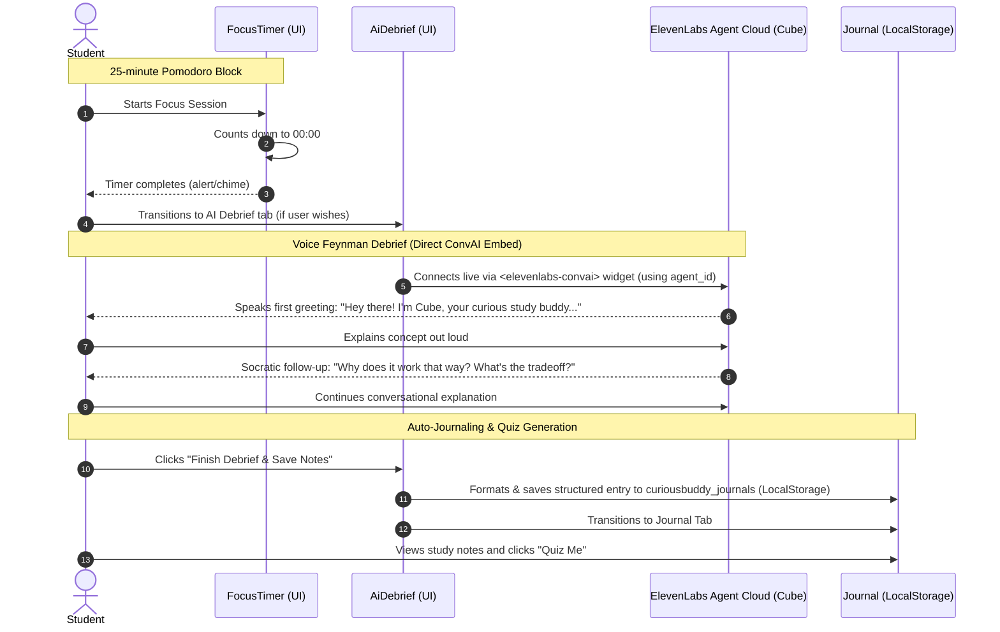

# curiousBuddy — Hackathon Master Plan (`plan.md`)

## 1. Executive Summary & Vision

**curiousBuddy** is an active-learning Pomodoro study companion that replaces passive re-reading with the **Feynman Technique**. When a study session ends, a curious Socratic AI debriefs you via voice on what you just learned, automatically turns your explanation into a structured study journal entry, tracks your daily focus hours in `localStorage`, and lets you generate instant quizzes to test your retention.

### Key Architectural Decision: ElevenLabs Conversational AI vs. Ollama

#### Do We Need Ollama?
**No. Ollama is not needed.**

#### Why? Does the ElevenLabs Agent Have World Knowledge?
**Yes, 100%.**
Every ElevenLabs Conversational Agent is powered by an integrated frontier Large Language Model (such as Gemini 1.5 Flash, GPT-4o, or Claude 3.5 Sonnet) configured inside ElevenLabs.
- **Broad World Knowledge**: The agent already possesses encyclopedic knowledge across computer science, engineering, physics, mathematics, history, biology, literature, and system architecture.
- **Zero Local Hardware Load**: Running Ollama locally requires downloading 2–4 GB model weights, high GPU/RAM consumption, and running an extra background daemon (`ollama serve`).
- **Sub-Second Voice Latency**: ElevenLabs provides an end-to-end cloud pipeline (Speech-to-Text $\rightarrow$ LLM Reasoning $\rightarrow$ Text-to-Speech) with $\approx 200\text{–}400\text{ms}$ turnaround time. An external localhost Ollama would introduce a 2–4 second lag and require ngrok tunneling to the internet.

---

## 2. ElevenLabs Agent Creation Strategy (via API)

Following the official [ElevenLabs Agents Quickstart](https://elevenlabs.io/docs/eleven-agents/quickstart):

We programmatically provision the Socratic agent using the ElevenLabs Python SDK via `backend/app/services/create_agent.py`:

```python
from app.config import settings
from elevenlabs.client import ElevenLabs

# Load API key and voice preferences directly from app.config.settings
client = ElevenLabs(api_key=settings.ELEVENLABS_API_KEY)

feynman_prompt = """
# Personality
Your name is Cube. You are a curious study buddy, an enthusiastic, highly curious, and slightly skeptical study companion.

# Goal
Practice the Feynman Technique with the student.
When they explain what they just studied:
1. Identify any jargon or buzzwords they used and ask them to explain what that actually means in plain, everyday language.
2. Ask probing 'why' and 'how' follow-up questions to test deep mechanical understanding.
3. Challenge them with simple real-world thought experiments and edge cases.
4. Keep your responses conversational, friendly, and concise (2-3 sentences max).

# Tone
Speak in a friendly, conversational manner
"""

response = client.conversational_ai.agents.create(
    name="curiousBuddy Feynman Debriefer (Cube)",
    tags=["curiousBuddy", "feynman", "education"],
    conversation_config={
        "tts": {
            "voice_id": "cgSgspJ2msm6clMCkdW9",  # Jessica (Playful, Cute, Youthful)
            "model_id": "eleven_flash_v2"
        },
        "agent": {
            "first_message": (
                "Hey there! Great focus session. I'm Cube, your curious study buddy. "
                "What's the core concept you just studied? Explain it to me as if I'm 12 years old!"
            ),
            "prompt": {
                "prompt": feynman_prompt,
            }
        }
    }
)

agent_id = response.agent_id
# Use agent_id in ELEVENLABS_AGENT_ID and frontend <elevenlabs-convai> widget
```

---

## 3. System Architecture & Component Mapping

```text
curiousBuddy/
├── plan.md                                # Master plan & architectural roadmap
├── backend/
│   ├── .env                              # ELEVENLABS_API_KEY, ELEVENLABS_AGENT_ID, PORT
│   ├── requirements.txt                  # fastapi, uvicorn, python-dotenv, pydantic, elevenlabs
│   ├── tests/
│   │   └── test_elevenlabs.py            # Automated tests for API connection and agent creation
│   └── app/
│       ├── config.py                     # Environment loader & Pydantic settings singleton
│       ├── schemas.py                    # API request & response schemas
│       ├── main.py                       # FastAPI entrypoint
│       └── services/
│           └── create_agent.py           # Automated script & service to provision ElevenLabs agent (Cube)
└── frontend/
    ├── index.html                        # Web embed script tag for ElevenLabs convai widget
    ├── package.json                      # React 19, Vite, TypeScript
    └── src/
        ├── App.tsx                       # Main shell (Focus Timer | AI Debrief | Journal | Stats)
        ├── types.ts                      # Data contracts (ChatMessage, JournalEntry, UserStats)
        ├── index.css                     # Minimal Swiss brutalism (border-radius: 0) & responsive design
        ├── utils/
        │   └── sound.ts                  # Web Audio API chime & click synthesizer
        └── components/
            ├── FocusTimer.tsx            # Host component for focus sessions
            ├── timer/
            │   ├── Focus.tsx             # 25m focus countdown & topic selector
            │   ├── ShortBreak.tsx        # 5m recharge timer
            │   ├── LongBreak.tsx         # 15m deep rest timer
            │   └── ClockDial.tsx         # Minimal circular ring dial (responsive & live)
            ├── AiDebrief.tsx             # ElevenLabs Conversational Voice Agent (Cube) + Socratic debrief
            ├── Journal.tsx               # Markdown notes archive & interactive "Quiz Me" modal
            └── Stats.tsx                 # Streak counter, minutes studied, completed blocks
```

---

## 4. Communication & Data Flow



---

## 5. Step-by-Step Implementation Roadmap

### Phase 1: Agent Creation Service via API
- [x] Research official ElevenLabs Quickstart API.
- [x] Implement `backend/app/services/create_agent.py` using `client.conversational_ai.agents.create`:
  - Name: `curiousBuddy Feynman Debriefer (Cube)`
  - Socratic Feynman System Prompt with `# Personality` (Cube), `# Goal`, and `# Tone`
  - First message: greeting student as Cube and asking for a 12-year-old explanation
  - Selected Voice (`Rachel` or `Brian`)
  - Standalone runnable script and callable function
  - Output generated `agent_id` for `ELEVENLABS_AGENT_ID` and frontend widget embedding.
- [x] Run `create_agent.py` to provision the agent in ElevenLabs and verify agent ID:
  - **Created Agent ID**: `agent_8001m5pswf1decw9rddgvezyysgz`
  - Saved to `backend/.env` as `ELEVENLABS_AGENT_ID`.

### Phase 2: Frontend Voice Agent Embed & Verification
- [x] Add `<script src="https://unpkg.com/@elevenlabs/convai-widget-embed">` in `frontend/index.html`.
- [x] Register custom element `<elevenlabs-convai>` in TypeScript definitions.
- [x] Embed `<elevenlabs-convai agent-id={agentId}>` into `frontend/src/components/AiDebrief.tsx`.
- [x] Socratic text debrief + speech recognition fallback.
- [x] Connect "Save to Journal" action to generate study notes and redirect to Journal.

### Phase 3: End-to-End Verification
- [x] Run `create_agent.py` to obtain official `agent_id` (`agent_8001m5pswf1decw9rddgvezyysgz`).
- [x] Verify frontend renders the ElevenLabs widget cleanly with zero console errors.
- [x] Test the full loop: Focus Timer $\rightarrow$ User transitions to Debrief $\rightarrow$ Spoken voice dialogue with Cube $\rightarrow$ Save notes $\rightarrow$ Interactive quiz in Journal.

### Phase 4: Knowledge Graph & Visual Learning Web (Upcoming)
- [ ] Implement an interactive 2D force-directed knowledge graph in `Journal.tsx` (similar to Obsidian's graph view).
- [ ] Extract semantic keywords and prerequisite links between journal entries.
- [ ] Enable interactive node inspection: click any node to pull up the associated Feynman study notes and quiz questions.